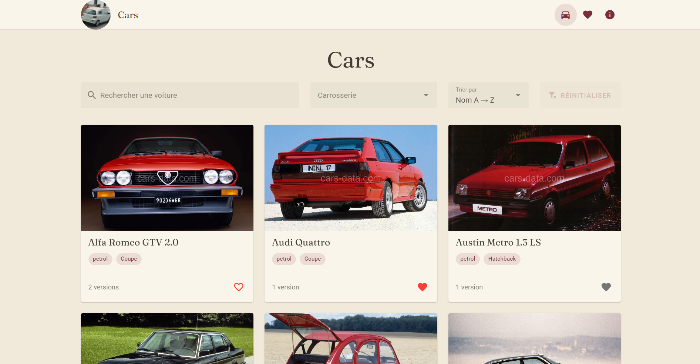
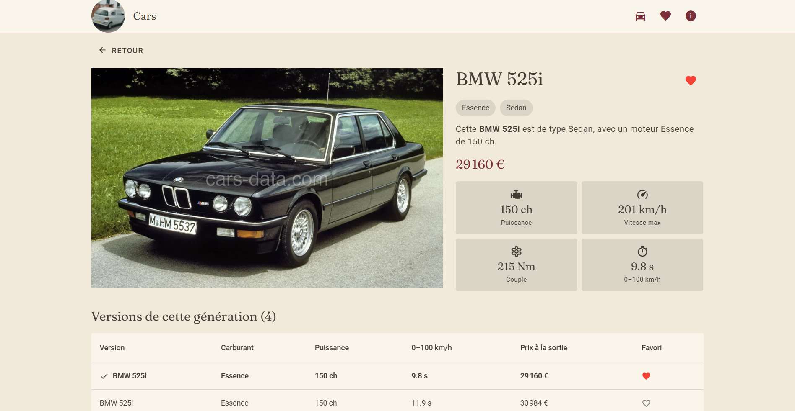
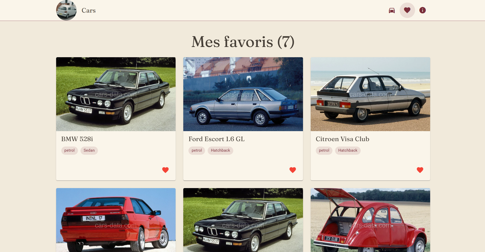
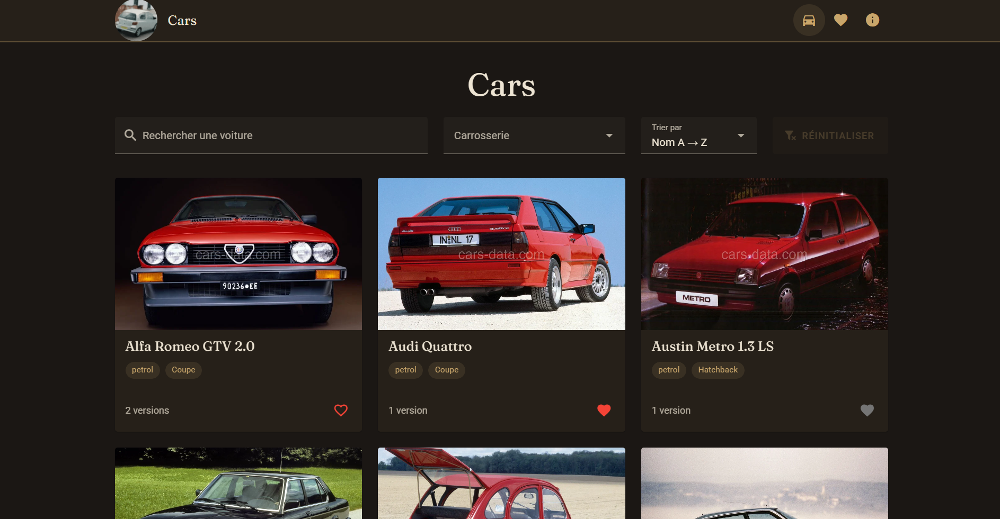
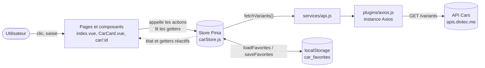

# 🚗 Cars — encyclopédie des voitures (Vue 3 + Vuetify)

Projet individuel évaluatif du module **M294** — Andrii Dimov

- 🌍 **Site en ligne (Vercel)** : https://294-project-cars-dimoand.vercel.app/
- 💻 **Dépôt GitHub** : https://github.com/BratishaDev/294-project-cars-dimoand
- 📖 **Documentation de l'API** : https://apis.divtec.me/api/cars/docs

---

## 1. 🎨 Présentation du projet

### Concept

**Cars** est une encyclopédie électronique de voitures : on parcourt un catalogue, on cherche un modèle, on ouvre sa fiche détaillée (photos, caractéristiques, prix) et on garde ses voitures préférées en favoris.

- **API choisie** : l'API *Cars* du cours (`https://apis.divtec.me/api/cars`), qui fournit des versions de voitures avec leurs caractéristiques, leur prix et des photos.
- **Public cible** : les passionnés d'automobile qui veulent comparer rapidement les différentes versions d'un même modèle.
- **Objectifs de l'application** : consulter un catalogue clair, retrouver une voiture (recherche, filtre, tri), comparer les versions d'une génération et conserver ses favoris d'une visite à l'autre.

**Pourquoi les voitures ?**: J'ai choisi les voitures parce que c'est un sujet qui m'intéresse beaucoup et que les données de l'API original sont riches : chaque modèle a plusieurs versions, des photos et des caractéristiques à comparer.

### Fonctionnalités principales

- **Catalogue** : les versions de l'API sont regroupées par **génération** (une carte par génération, avec le nombre de versions).
- **Recherche / filtre / tri** : recherche par nom, filtre par carrosserie, tri A → Z ou Z → A, bouton « Réinitialiser ». Les filtres sont gardés quand on ouvre une voiture puis qu'on revient au catalogue.
- **Vue détail** (`/car/:id`) : galerie de photos, caractéristiques (puissance, vitesse max, couple, 0–100 km/h), prix, et tableau de toutes les versions de la génération (cliquables, y compris au clavier).
- **Favoris** : cœur à **trois états** (cette version en favoris / une autre version de la génération en favoris / aucun favori), page dédiée « Mes favoris », message de confirmation (snackbar).
- **Persistance locale** : les favoris sont sauvegardés dans le `localStorage` et retrouvés après un rafraîchissement ; les favoris qui n'existent plus dans l'API sont nettoyés automatiquement.
- **États de l'interface** : squelettes de chargement, message d'erreur si l'API est indisponible, message si aucun résultat, page 404, alerte si l'identifiant de la voiture n'existe pas.
- **Thème** « salon des années 60 » (cuir, laiton, bordeaux), **clair ou sombre automatiquement** selon l'appareil, police Fraunces pour les titres, animation du cœur.

### Aperçu visuel



| Détail d'une voiture | Mes favoris | Thème sombre |
|---|---|---|
|  |  |  |

---

## 2. 📚 Parcours d'apprentissage

### Ressources utilisées

#### Documentation & tutos
- [Vue 3 Docs](https://vuejs.org/guide/introduction.html)
- [Vuetify Docs](https://vuetifyjs.com/en/components/all/)
- [Pinia Docs](https://pinia.vuejs.org/)
- [Vue Router Docs](https://router.vuejs.org/)
- [Axios Docs](https://axios-http.com/docs/intro)
- [MDN — localStorage](https://developer.mozilla.org/fr/docs/Web/API/Window/localStorage)
- [Exercices « Pokédex Vuetify »](https://devjs.ch/exercices/pokedex-vuetify/) (devjs.ch) : base de la structure, des props, du routeur, de Pinia, d'Axios et des favoris
- [Documentation de l'API Cars](https://apis.divtec.me/api/cars/docs)

#### Progression
- **22.09** : création du dépôt à partir du modèle Vuetify fourni.
- **Semaine 1 (20.10)** : liste de cartes, composant `CarCard.vue`, en-tête, pied de page, logo, image par défaut, première page voiture.
- **Semaine 2 (27.10)** : pages « À propos » et « Favoris », premier store Pinia, regroupement des versions par génération.
- **Semaine 3 (01–03.11)** : galerie de photos, passage à Axios avec variables d'environnement (`.env`), squelettes de chargement et gestion des erreurs, page voiture complète avec tableau des versions, déploiement sur Vercel (réécriture SPA).
- **Semaine 4 (09–10.11)** : recherche / filtre / tri, favoris avec `localStorage`, cœur à trois états, animation, thème « années 60 », accessibilité, couche `services/api.js`, commentaires du code, README.

---

## 3. 🛠️ Outils et méthodologie

### Environnement de développement
- **IDE** : WebStorm.
- **Versioning** : Git + GitHub (branche `main`, plus de 35 commits au format « Conventional Commits » en français : `feat:`, `fix:`, `style:`, `chore:`)
- **Dépendances principales** : Vue 3, Vuetify 3, Pinia, Axios, Vue Router (routes automatiques à partir du dossier `pages/`), Vite
- **Gestion API Keys** : `.env` + `.env.example`. L'API Cars **n'a pas besoin de clé** : le fichier `.env` ne contient que l'adresse de l'API (`VITE_API_URL`). Il est ignoré par Git (`.gitignore`) ; seul `.env.example` est versionné.

### Installation & Run

```bash
# 1. Cloner le dépôt
git clone https://github.com/BratishaDev/294-project-cars-dimoand.git
cd 294-project-cars-dimoand

# 2. Installer les dépendances (Node.js 18 ou plus récent)
npm install

# 3. Variables d'environnement : copier le modèle (Windows : copy .env.example .env)
cp .env.example .env

# 4. Lancer en mode développement → http://localhost:3000
npm run dev
```

Autres commandes : `npm run build` (version de production dans `dist/`) et `npm run preview` (tester cette version).

**Variables d'environnement** : copier `.env.example` → `.env`.

| Variable | Rôle | Valeur par défaut |
|---|---|---|
| `VITE_API_URL` | Adresse de base de l'API | `https://apis.divtec.me/api/cars` |

Si la variable est absente, l'application utilise automatiquement cette valeur par défaut (c'est le cas sur Vercel).

**Déploiement** : Vercel. Le fichier `vercel.json` renvoie toutes les adresses vers `index.html` afin que le rafraîchissement d'une page comme `/car/12` fonctionne (application à page unique).

### Méthodologie
- Découpage en composants réutilisables : `CarCard.vue` sert dans le catalogue **et** dans les favoris.
- Props clairs : `CarCard` reçoit `car` (obligatoire) et `count` (optionnel : le nombre de versions n'est affiché que dans le catalogue). Aucun événement personnalisé (`emit`) n'est nécessaire : les actions passent directement par le store.
- Store global avec Pinia : toutes les pages lisent les mêmes données, l'API n'est appelée qu'une seule fois au démarrage.
- Séparation des responsabilités : composants (affichage) → store (logique et état) → `services/api.js` (requêtes HTTP) → instance Axios (configuration).
- Commits réguliers et explicites.
- Tests manuels (interface, persistance, erreurs de l'API, accessibilité) — voir section 4.
- Code commenté en français, surtout les parties complexes (regroupement par génération, favoris, gestion d'erreurs).

### Choix techniques
- **API sélectionnée** : API *Cars* du cours — `https://apis.divtec.me/api/cars`
- **Justification du choix** : données riches et variées (photos, puissance, prix, carrosserie, carburant), une relation intéressante *génération → versions* qui permet de travailler le regroupement et la vue détail, aucune clé API à protéger, adresse stable.
- **Endpoints utilisés** : `GET /variants?limit=100` (toutes les versions en une seule requête ; l'API en contient 50). Le détail d'une voiture est retrouvé dans les données déjà chargées, sans requête supplémentaire.
- **Limites / quotas connus** :
  - pas de clé API ni de quota rencontré pendant le développement ;
  - certaines versions n'ont pas toutes les données (`url` des photos, `topSpeedKmh`, `accel0100S`) : l'interface affiche une image par défaut ou « — » ;
  - les photos viennent d'un site externe (`img.cars-data.com`) : certaines contiennent un filigrane et l'application dépend de la disponibilité de ce site.

### Choix de conception importants
- **Une carte par génération** : plusieurs versions partagent le même `generationId`. Le getter `generations` les regroupe (avec une `Map`) ; la carte montre la première version et le nombre de versions.
- **Favoris = identifiants de versions** (`car.id`), stockés dans le `localStorage` sous la clé `car_favorites`. Le cœur d'une carte a trois états, car la carte représente une génération mais le favori est une version précise.
- **Recherche, filtre et tri dans le store** (et non dans la page) : ils sont conservés quand on navigue vers une voiture puis qu'on revient.
- **Protection des favoris** : si l'API ne répond pas, la liste de voitures est vide ; le nettoyage des favoris est alors ignoré pour ne pas les effacer à cause d'une simple panne réseau.

### Architecture

```text
src/
├── App.vue                 # racine : en-tête, pied de page, charge le store au démarrage
├── main.js                 # démarrage de l'application
├── components/
│   ├── AppHeader.vue       # barre de navigation + logo animé au survol
│   ├── AppFooter.vue       # pied de page
│   └── CarCard.vue         # carte d'une voiture (catalogue et favoris)
├── layouts/default.vue     # mise en page commune (<v-main> + <router-view>)
├── pages/                  # une page = une route (routes automatiques)
│   ├── index.vue           # /            catalogue : recherche, filtre, tri
│   ├── car/[id].vue        # /car/:id     détail d'une version
│   ├── favoris.vue         # /favoris     voitures favorites
│   ├── a-propos.vue        # /a-propos
│   └── [...path].vue       # toute autre adresse → page 404
├── stores/carStore.js      # store Pinia : état, getters, actions, favoris
├── services/api.js         # fonctions d'accès à l'API (fetchVariants)
├── plugins/
│   ├── axios.js            # instance Axios (adresse de l'API, en-têtes, timeout)
│   └── vuetify.js          # thèmes clair / sombre
└── styles/                 # variables Vuetify (settings.scss) et styles du thème (vintage.css)
```

**Schéma simple :**



**Data-flow résumé :**
- Au démarrage, `App.vue` appelle `carsStore.init()` : le store lit d'abord les favoris dans le `localStorage`, puis demande les voitures à l'API (`fetchCars` → `services/api.js` → Axios).
- Les voitures arrivent dans `state.cars`. Les getters les transforment : `filteredCars` (recherche + filtre + tri) → `generations` (regroupement par `generationId`). La page catalogue affiche une `CarCard` par génération.
- Un clic sur le cœur appelle `toggleFavorite(car)` : le store modifie `state.favorites` et sauvegarde dans le `localStorage`. Tous les composants qui lisent les favoris se mettent à jour automatiquement.
- Pendant la requête, `isLoading` affiche les squelettes ; en cas d'échec, `error` affiche un message d'erreur.

---

## 4. 🧪 Tests et validation

### Tests techniques
- ✅ Appels API fonctionnels : les 50 versions se chargent (`GET /variants`).
- ✅ Persistance vérifiée après rafraîchissement (`localStorage`) : les favoris sont conservés.
- ✅ Navigation entre les vues : catalogue, détail, favoris, à propos ; bouton « Retour » correct, y compris quand on ouvre une page voiture directement.
- ✅ Accès direct et rafraîchissement sur `/car/:id` (réécriture Vercel).
- ✅ `npm run build` se termine sans erreur ; aucune erreur dans la console du navigateur.
- ✅ Les photos ou données manquantes d'une voiture ne cassent pas l'affichage (image par défaut, « — »).

### Tests d'UX
- Navigation simple : 3 icônes dans la barre (accueil, favoris, à propos), cartes entièrement cliquables.
- Recherche, filtre et tri faciles à comprendre ; le bouton « Réinitialiser » est désactivé tant qu'aucun filtre n'est actif.
- Feedback utilisateur : squelettes pendant le chargement, message d'erreur, message si aucun résultat, message de confirmation (snackbar) quand on ajoute ou retire un favori.
- Interface adaptée aux écrans mobile (375 px), tablette (768 px) et ordinateur (1280 px) : aucun défilement horizontal sur les 4 pages.

### Tests d'accessibilité
- Contraste des couleurs : texte principal 14,1:1 (thème clair) et 12,8:1 (thème sombre) ; couleur principale 8,5:1 et 7,0:1 ; cœur gris 4,2:1 / 3,5:1 (minimum recommandé : 3:1 pour les éléments d'interface).
- Libellés : champs avec `label`, boutons à icône avec `aria-label` et `title`, images avec `alt`, `<html lang="fr">`, un seul `<main>`.
- Navigation clavier possible : logo (touche Entrée), liens et boutons de la barre, cartes, cœurs, lignes du tableau des versions (Tab + Entrée).
- Focus visible : les styles de focus de Vuetify et du navigateur sont conservés (aucun style ne les supprime).
- Thème clair ou sombre appliqué automatiquement selon la préférence de l'appareil.
- Non testé : lecteur d'écran réel (NVDA, VoiceOver).

### Tests d'erreurs & fallback
- API indisponible (erreur simulée) → message d'erreur (`v-alert`) sur le catalogue, sur la page détail et sur la page favoris ; les favoris restent intacts dans le `localStorage`.
- Pas de réponse de l'API → arrêt de la requête après 10 secondes (timeout) puis message d'erreur, au lieu de squelettes infinis.
- Recherche sans résultat → « Aucune voiture ne correspond à votre recherche. »
- Aucun favori → message clair qui explique comment en ajouter.
- Identifiant inconnu (`/car/abc`) → « Voiture non trouvée. » ; adresse inconnue → page 404.
- `localStorage` illisible ou modifié à la main → les favoris sont simplement réinitialisés (`try/catch`), sans plantage.
- Pas de *mock* de secours : il n'est pas exigé pour l'année 26-27.

---

## 5. 🤖 Usage d'intelligence artificielle

### IA utilisée
- **Nom** : Claude (Anthropic), utilisé comme tuteur et assistant de code dans l'application Claude
- **Version** : Claude Sonnet 5.5
- **Contexte** : explications du code, aide au débogage, génération de snippets que j'ai ensuite adaptés, relecture finale

### Utilisation détaillée

**Domaines d'aide**:
- Aide au code général (explications de JavaScript / Vue, « que fait cette ligne ? ») : 25%
- Génération de snippets Vue/Vuetify : 25%
- Aide à la structuration du projet : 10%
- Debugging : 30%
- Recherche d'idées : 10%

**Ce que l'IA a fait, et ce que j'ai fait ou modifié :**

| Sujet | Aide de l'IA | Mon travail / mes modifications |
|---|---|---|
| Store Pinia (`carStore.js`) | Explication de `state` / `getters` / `actions` ; version de départ du getter qui regroupe les versions par `generationId` | Idée du regroupement par génération ; connexion aux pages ; correction de mes erreurs (`response.data.data`, accolade en trop, `this`, `Number()` pour les ID) |
| Axios + variables d'environnement | Explication de l'instance Axios et de `import.meta.env` | Création de l'instance, de `.env` / `.env.example` ; retrait du `.env` du dépôt |
| Recherche / filtre / tri | Présentation de plusieurs options d'affichage (carte = génération ou version) ; code du getter `filteredCars` | Choix de l'option retenue, bouton de réinitialisation, tri A → Z par défaut |
| Favoris (`localStorage`) | Code de base (`toggleFavorite`, `loadFavorites`, `saveFavorites`, nettoyage) | Idée du cœur à trois états ; placement du cœur sur la carte et sur la page voiture |
| Galerie de photos | Correction de ma première version (`v-if` et `v-for` sur le même élément, `key`) ; `v-model` pour démarrer sur la 2e photo | Idée de la galerie ; choix de ne pas en faire un composant séparé |
| Thème « années 60 » | Proposition de palette et de police (Fraunces) | Demande de l'ambiance (rétro / premium, couleurs sombres et douces) ; choix final |
| Relecture finale (10.11) | Vérification par rapport aux consignes, correction de l'accessibilité (libellés, clavier), états de chargement/erreur de la page voiture, `services/api.js`, ajout des commentaires manquants ; contrôle automatique du site dans un navigateur | Application et vérification des changements dans mon projet |
| Documentation | Ébauche du README à partir de l'historique du projet | Relecture, corrections, parties personnelles |

**Compréhension et adaptation**
- Claude a expliqué le code **ligne par ligne** (props, `ref` et `.value`, getters Pinia, `storeToRefs`, déstructuration, `Map`, `Array.from`, `?.` et `??`…) et m'a posé des questions de contrôle pour vérifier ma compréhension.
- Les exemples du tutoriel Pokédex (Pokémon) ont été transposés aux voitures : adaptation à la structure des données de l'API (réponse `{ data, pagination }`, champs optionnels, photos multiples, `generationId`).
- Chaque snippet a été relu, testé et corrigé dans mon projet avant d'être gardé ; plusieurs bugs venaient de mes propres essais et ont été corrigés avec l'aide de l'IA.
- J'ai remplacé le tri par date par un tri alphabétique par défaut. J'ai gardé l'animation du cœur telle quelle car elle n'influence pas la fonctionnalité. J'ai changé les couleurs de la palette pour les adapter à mes goûts.

### Parties codées manuellement

- Composants principaux (`CarCard`, pages, en-tête) : **60%** personnel
- Store & persistance : **30%** personnel
- Routing & navigation : **70%** personnel
- Tests & validation : **100%** personnel pour les tests manuels (un contrôle automatique supplémentaire a été lancé par Claude lors de la relecture finale)

### Apprentissage personnel
- **Ce que j'ai appris grâce à l'IA** : composants et props, réactivité (`ref`, `computed`, `watch`), routeur (`useRoute` et `useRouter`), logique de Pinia (state, getters, actions), appels Axios, `localStorage`.
- **Comment elle m'a aidé à progresser** : explications étape par étape, correction de mes erreurs en m'expliquant pourquoi elles se produisaient, questions de contrôle pour vérifier que je comprenais.

**Une phrase sincère sur ma progression**:
Au début, je comprenais à peine JavaScript, sans parler de mes connaissances en Vue.js et Vuetify.
Mais grâce à ce projet, j'ai approfondi mes connaissances dans ce domaine et j'ai compris toutes les possibilités que la maîtrise de JavaScript, de Vue.js et de Vuetify offre en matière de développement.

---

## 6. 🎯 Bilan personnel

### Ce que j'ai appris
- **Compétences techniques** : créer et réutiliser des composants Vue avec props, gérer un état global avec Pinia, appeler une API avec Axios, utiliser le routeur (pages dynamiques `/car/:id`), sauvegarder des données dans le `localStorage`, utiliser les composants Vuetify, déployer sur Vercel.
- **Concepts difficiles** : Pinia (différence entre `state`, `getters` et `actions`, et pourquoi un getter qui en utilise un autre doit être une fonction normale) ; la réponse de l'API enveloppée dans `data.data` ; la différence entre un identifiant texte (`"12"`, venant de l'URL) et un nombre (`12`).
- **Une découverte surprenante »**:
J'ai été surpris de voir que `1 === "1"` est faux en JavaScript : ma page voiture restait vide à cause de ça. »*

### Difficultés rencontrées
- **Réponse de l'API** : les cartes restaient vides parce que je lisais `response.data` au lieu de `response.data.data` → corrigé en regardant la structure de la réponse (`{ data, pagination }`).
- **Identifiants** : `car.id === route.params.id` ne trouvait jamais la voiture (nombre contre texte) → conversion avec `Number()`.
- **Plusieurs versions par modèle** : le catalogue affichait trop de cartes → regroupement par `generationId` avec une `Map`.
- **Photos manquantes ou filigranées** : chaîne de secours `url?.[1] || url?.[0] || image par défaut`.
- **Erreurs de syntaxe dans le store** (accolade en trop, guillemet mal placé, getter placé dans `actions`) → lecture attentive des erreurs de Vite.
- **Fichier `.env` envoyé par erreur sur GitHub** → retiré du suivi Git (`git rm --cached`), ajouté au `.gitignore`, `.env.example` créé. Il ne contenait que l'adresse publique de l'API (aucun secret).
- **Message « Voiture non trouvée » qui clignotait** au rafraîchissement de la page voiture, pendant le chargement → ajout d'un état de chargement.
- **Aide reçue** : documentation officielle, tutoriel Pokédex de devjs.ch, enseignant, Claude (voir section 5).

**Un moment de blocage dont je me souviens et comment j'ai l'as dépassé.**
Pendant presque une heure, la page catalogue restait vide sans message d'erreur ; j'ai fini par ouvrir l'onglet « Réseau » du navigateur et j'ai vu que la réponse était enveloppée dans `data`.

### Réussites et fiertés
**Ce dont je suis fier**:
Cœur à trois états, qui m'a demandé de bien comprendre les getters » / « le regroupement par génération » / « le thème "années 60", qui rend l'application vraiment différente d'un exemple de cours » / « avoir compris Pinia alors que c'était flou au début ».

- **Progrès constatés** : au début, je ne savais ni passer des données à un composant ni appeler une API ; à la fin, l'application charge des données, les filtre, les regroupe, les sauvegarde et gère les erreurs.
- **Envies de développement futur** : voir ci-dessous.

### Améliorations possibles
- **Avec plus de temps** : pagination ou bouton « Charger plus » si le catalogue grandit ; filtre par carburant et tri par puissance ou par prix ; comparaison côte à côte de deux versions.
- **Fonctionnalités bonus** : image de secours quand une photo externe ne se charge pas ; aucune animation du cœur au chargement de la page (seulement au clic) ; texte secondaire plus contrasté en thème clair (« N versions » : 4,0:1, viser 4,5:1).
- **Compétences à approfondir** : tests automatiques (Vitest), TypeScript, accessibilité avancée (test avec un lecteur d'écran).

---

## 7. 📚 Références & Sources

- Documentation de l'API : [API Cars — apis.divtec.me](https://apis.divtec.me/api/cars/docs)
- Tutos clés utilisés : [Exercices Pokédex Vuetify (devjs.ch)](https://devjs.ch/exercices/pokedex-vuetify/), [Vue 3](https://vuejs.org/guide/introduction.html), [Vuetify](https://vuetifyjs.com/en/components/all/), [Pinia](https://pinia.vuejs.org/), [Vue Router](https://router.vuejs.org/), [Axios](https://axios-http.com/docs/intro)
- Usage de l'IA : voir la section 5 ci-dessus
- Autres ressources utiles :
  - [MDN — localStorage](https://developer.mozilla.org/fr/docs/Web/API/Window/localStorage)
  - [Police Fraunces (Google Fonts)](https://fonts.google.com/specimen/Fraunces)
  - [Material Design Icons](https://pictogrammers.com/library/mdi/) (icônes)
  - [cars-data.com](https://www.cars-data.com/) (origine des photos des voitures fournies par l'API)
